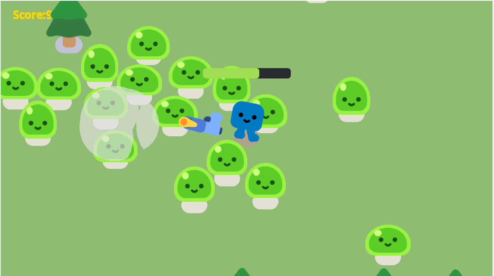
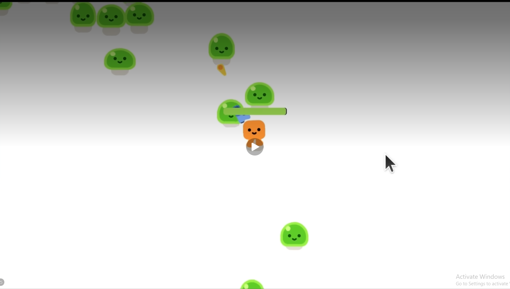
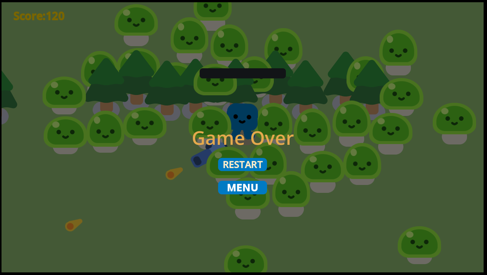

# Last Stand

Last Stand is one of my proudest moments in my journey as a developer. I created this game using Godot Engine, and honestly, it feels so cool and amazing to have built something like this myself.

The game is about escaping from slimes and trying not to get caught. Your goal is to survive and stay alive while avoiding the slimes.

I really enjoyed building this game along the way. Exploring Godot, working with physics, adding cool mechanics, and figuring things out as I developed the game made this project special to me.

There were many things to learn, and I enjoyed the process of turning my ideas into an actual playable game.

I'm proud of what I've created, and I'm looking forward to building even more interesting projects in the future.

## Play the Game

You can play Last Stand here:

[Play Last Stand on itch.io](https://raphelreji.itch.io/last-stand)

## Screenshot

## How to Play

Use the following keyboard controls to move your character:

| Key | Action |
|---|---|
| W | Move Up |
| A | Move Left |
| S | Move Down |
| D | Move Right |

**Note:** Arrow keys are not supported. Use WASD to play.

## Credits

- **GDQuest** – For the 2D game development tutorial that helped me learn and build this project.
- **Assets** – Thanks to the original asset creators for the resources used in this game.

## What I Changed from the Tutorial

### Original Tutorial vs My Game

| Original Tutorial | My Game |
|---|---|
|  |  |

### Original Tutorial
The original game was a basic shooting game with a simple map. It had no main menu, restart button, or proper interface.

### What I Added
- Designed a new environment with trees, assets, and different areas.
- Completely changed the game's visual theme and player colour.
- Added more slime enemies.
- Added a scoring system (10 points for each slime killed).
- Added a live score update.
- Created a main menu with a Play button.
- Added a Game Over screen, Restart button, and Main Menu button.
- Polished the game myself.
---

Thanks for checking out!
